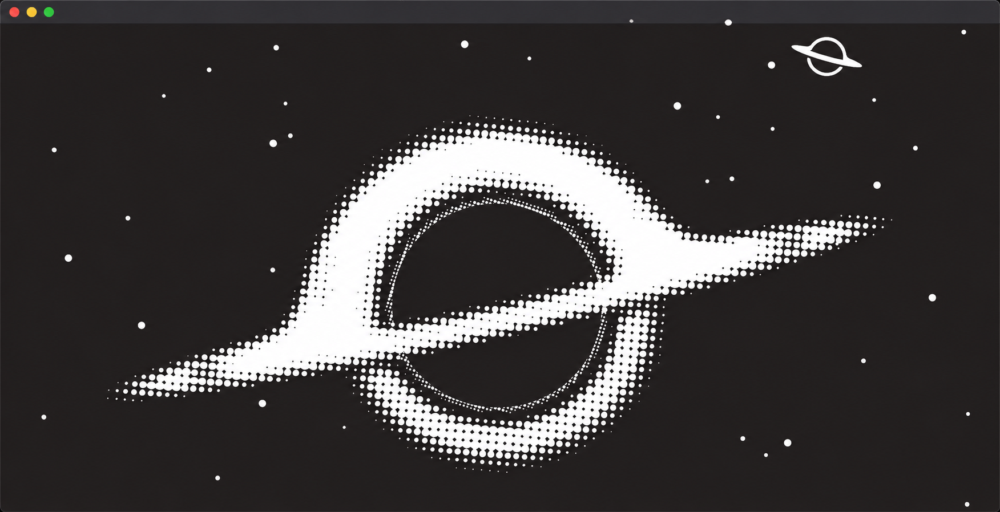
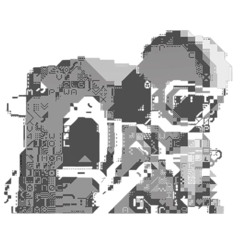

<!-- ==================== HEADER ==================== -->

  

<h1 align="center">Pedro Corrêa</h1>

<h3 align="center">Full-stack Developer</h3>

  

Turning curiosity into code.

<!-- ==================== ABOUT ME ==================== -->
## <h2 align="center">🚀 About Me </h2>

  Hi! I'm Corrêa, a Systems Analysis and Development student
  from Brazil, passionate about technology, science,
  and understanding how things work.

  Currently building my foundations in software
  development, exploring different technologies,
  and turning ideas into projects.

  My main interests lie in <b>Artificial Intelligence,
  Cybersecurity</b> and <b>Software Engineering</b>.

  Outside of programming, I enjoy exploring the
  universe through astronomy, astrophysics,
  and scientific literature.

<h3>Currently:</h3>

<ul>
  <li>🎓 Studying Systems Analysis and Development.</li>
  <li>💻 Learning C, Python, and Web Development.</li>
  <li>🐧 Using Fedora Linux as my development environment.</li>
  <li>🚀 Building projects and improving my skills.</li>
</ul>

 

 <h2 align="center">🤝 Talk to me!</h2>

  
  &nbsp;&nbsp;&nbsp;
  
  &nbsp;&nbsp;&nbsp;
  
  &nbsp;&nbsp;&nbsp;
  

 

<!-- ==================== TECH STACK ==================== -->
<h2 align="center">💻 Tech Stack</h2>

  

  

---
 

  

---
