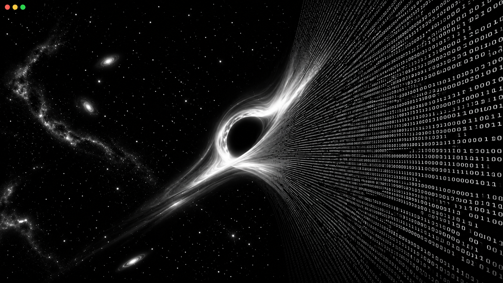

<!-- ==================== CABEÇALHO ==================== -->

  

  
    <a href="./README.md">🇺🇸 EN</a>
    &nbsp;|&nbsp;
    <a href="./README.pt-br.md">🇧🇷 PT</a>
  

<h1 align="center">Pedro Corrêa</h1>

<h3 align="center">Desenvolvedor de Software em formação</h3>

  

<!-- ==================== SOBRE MIM ==================== -->
## <h2 align="center">🚀 Sobre mim </h2>

  Olá! Sou Pedro Corrêa, estudante brasileiro de Análise e Desenvolvimento
  de Sistemas, apaixonado por tecnologia, ciência
  e por entender como as coisas funcionam.

  Atualmente, estou construindo minha base em desenvolvimento
  de software, explorando diferentes tecnologias
  e transformando ideias em projetos.

  Meus principais interesses são <b>Inteligência Artificial,
  Cibersegurança</b> e <b>Desenvolvimento de Software</b>.

  Fora da programação, gosto de explorar o universo
  por meio da astronomia, da astrofísica
  e da literatura científica.

<h3>Atualmente:</h3>

<ul>
  <li>🎓 Cursando Análise e Desenvolvimento de Sistemas.</li>
  <li>💻 Aprendendo C, Python e Desenvolvimento Web.</li>
  <li>🐧 Usando Fedora Linux como meu ambiente de desenvolvimento.</li>
  <li>🚀 Criando projetos e aprimorando minhas habilidades.</li>
</ul>

 

<!-- ==================== CONTATOS ==================== -->
 <h2 align="center">🤝 Fale comigo!</h2>

  
  &nbsp;&nbsp;&nbsp;
  
  &nbsp;&nbsp;&nbsp;
  

 

<!-- ==================== TECH STACK ==================== -->
<h2 align="center">💻 Tech Stack</h2>

  

<!-- ==================== IDE e OS ==================== -->

  

<!-- ==================== BANNER ==================== -->
---
 

  

---
